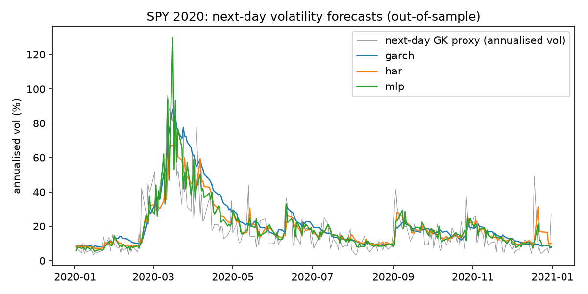

# Volatility Forecaster

Forecasts SPY's next-day variance with four models and tests, out of sample and with significance tests, whether a neural network actually beats the classical baselines.

**Result: the MLP beats HAR-RV and GARCH, but no better than a linear model given the same inputs (Diebold-Mariano p = 0.51).** The improvement comes from the features (log transform and the leverage effect), not from the nonlinearity.

## Setup

- **Data:** SPY daily OHLC, 2000-2025 (Yahoo Finance, split/dividend-adjusted).
- **Target:** next-day variance. Daily data has no intraday realized variance, so the proxy is the Garman-Klass range estimator (open/high/low/close). It's noisy and excludes overnight gaps.
- **Walk-forward:** expanding window, first 1,000 days for training, refit every 63 trading days, and each block predicted only by models fit before it. That gives 5,516 out-of-sample days, from January 2004 to December 2025, covering 2008 and 2020.
- **Loss:** QLIKE, the primary metric, is robust to noise in the variance proxy (Patton, 2011). RMSE on variance is reported as well.
- **Significance:** Diebold-Mariano test on QLIKE differences, Newey-West variance with 5 lags.

## Models

| Model | Inputs | Notes |
|---|---|---|
| `garch` | daily returns | GARCH(1,1), Gaussian MLE with variance targeting, written from scratch with scipy. Level rescaled on the training data to the GK proxy |
| `har` | rv: day, week (5d), month (22d) | HAR-RV (Corsi, 2009), OLS in levels. The baseline to beat |
| `linlog` | log rv (d, w, m), return, negative part of return | Ridge on log variance, Duan smearing to undo the log |
| `mlp` | same as `linlog` | MLP (16, 8), averaged over 3 seeds, same smearing |

`linlog` exists to isolate the effect of nonlinearity: it gets exactly the MLP's inputs.

## Results (out-of-sample, 2004-2025)

| Model | QLIKE ↓ | RMSE (var) ↓ | DM vs HAR | p |
|---|---|---|---|---|
| GARCH(1,1) | 0.408 | 2.20 | +4.44 (worse) | 9e-6 |
| HAR-RV | 0.383 | **2.15** | — | — |
| Linear-log | 0.354 | 2.37 | −6.83 (better) | 8e-12 |
| MLP | **0.352** | 2.17 | −5.28 (better) | 1e-7 |

**MLP vs linear-log: DM = −0.65, p = 0.51, not significant.**

By sub-period (QLIKE):

| Period | GARCH | HAR | Linear-log | MLP |
|---|---|---|---|---|
| 2008-2009 | 0.336 | 0.302 | **0.283** | 0.290 |
| 2020 | 0.576 | **0.528** | 0.550 | 0.550 |
| Excluding 2008, 2009, 2020 | 0.407 | 0.384 | 0.352 | **0.348** |



### What this says

1. **HAR beats GARCH.** This matches the literature: range-based variance carries more information than squared close-to-close returns. In the plot, GARCH is slow to come down after March 2020.
2. **Log features plus the leverage effect beat HAR on QLIKE.** Down days predict more volatility than up days.
3. **The neural net adds nothing statistically detectable** over a linear model with the same inputs. For one-step-ahead volatility, the gain is in feature design.
4. **The ranking depends on the loss function.** On RMSE, HAR is best and linear-log worst: log models under-forecast spike days, and squared error is dominated by those few days. QLIKE is the better-behaved loss here, but this sensitivity is worth stating.
5. **In 2020, plain HAR won.** A regime shock that fast favors the simplest model.

## Tests (`pytest`)

- **No lookahead:** scramble all raw data after day *k*; every model's forecasts up to day *k* must be identical. I checked that this test catches an injected leak (training on the block being predicted).
- **GARCH MLE** recovers α, β on simulated GARCH data.
- **QLIKE** is zero at the truth and positive elsewhere.
- **The Diebold-Mariano test** detects a 1.5× biased forecast.

## Run

```bash
python -m venv .venv && .venv/bin/pip install -r requirements.txt
.venv/bin/pytest -q
.venv/bin/python run_example.py   # ~2 minutes; downloads SPY and writes forecasts_2020.png
```

## Limitations

- The GK proxy isn't true realized variance. With 5-minute intraday data, both the target and HAR's inputs would be far less noisy.
- One asset (SPY) and one horizon (1 day). Multi-day horizons and a cross-section of assets would test robustness.
- MLP hyperparameters were set once and not tuned. Tuning would need a nested walk-forward to avoid overfitting the test period.
- The DM tests aren't adjusted for multiple comparisons, though the significant p-values are far below any reasonable correction.
- The GARCH level is rescaled to the proxy using training data only. Without that, it would be penalized for the overnight-gap mismatch rather than its dynamics.
